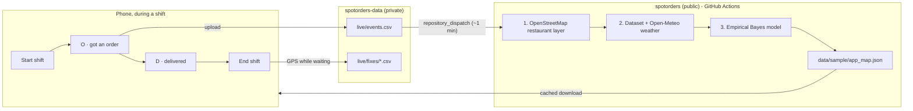
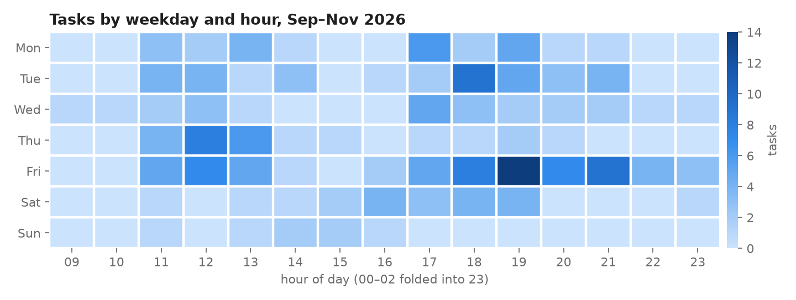

<p align="center">
  
</p>

<h1 align="center">Spotorders</h1>

<p align="center">
  <strong>Where should a bike courier wait so that the next delivery order comes fastest?</strong><br>
  An optimal-foraging study of my own food-delivery shifts in Helsinki, built with H3 hexagons, OpenStreetMap and Open-Meteo.
</p>

<p align="center">
  <a href="https://github.com/mdrifathahamed/spotorders/releases/latest/download/Spotorders.apk"><b>Download the app</b></a> ·
  <a href="#3-how-it-works">How it works</a> ·
  <a href="#4-the-android-app">The app</a> ·
  <a href="#9-the-model-and-the-map">The model</a> ·
  <a href="#12-what-the-data-say-so-far">Findings</a> ·
  <a href="#18-roadmap">Roadmap</a>
</p>

> **Note.** An independent personal project by Md Rifath Ahamed ([@mdrifathahamed](https://github.com/mdrifathahamed)). It is not
> affiliated with, endorsed by or connected to Wolt. It uses no Wolt API and does not read, scrape or automate the Wolt apps:
> every data point comes from my own button presses and my own shift records.

---

## Overview

| | |
|---|---|
| **Author** | Md Rifath Ahamed, MSc student in Ecology and Evolutionary Biology, University of Helsinki |
| **Repositories** | [`spotorders`](https://github.com/mdrifathahamed/spotorders) (public: code, documentation, aggregated map) · `spotorders-data` (private: logs, GPS, earnings) |
| **Latest release** | [`Spotorders.apk`](https://github.com/mdrifathahamed/spotorders/releases/latest/download/Spotorders.apk) · Android 8.0+ |
| **Current data** | 189 historical tasks (196 deliveries) · 2,173 OpenStreetMap food places · empirical Bayes model live |
| **Running cost** | **€0** (GitHub free tier, OpenStreetMap Overpass API, Open-Meteo) |
| **Licence** | MIT (code) · OpenStreetMap data © OpenStreetMap contributors (ODbL) |

## Contents

1. [Why build this?](#1-why-build-this)
2. [Goal and success measure](#2-goal-and-success-measure)
3. [How it works](#3-how-it-works)
4. [The Android app](#4-the-android-app)
5. [Data sources](#5-data-sources)
6. [The first dataset](#6-the-first-dataset)
7. [The pipeline](#7-the-pipeline)
8. [The restaurant layer](#8-the-restaurant-layer)
9. [The model and the map](#9-the-model-and-the-map)
10. [Automation](#10-automation)
11. [Privacy by design](#11-privacy-by-design)
12. [What the data say so far](#12-what-the-data-say-so-far)
13. [Setup and daily use](#13-setup-and-daily-use)
14. [Repository layout](#14-repository-layout)
15. [Data dictionary (short)](#15-data-dictionary-short)
16. [Design decisions](#16-design-decisions)
17. [Limitations](#17-limitations)
18. [Roadmap](#18-roadmap)
19. [Changelog](#19-changelog)

---

## 1. Why build this?

How long should a courier wait in one place before moving on? Anyone who has delivered food knows the question, even if
they have never put it into words. I am an MSc student in Ecology and Evolutionary Biology at the University of Helsinki,
and, like many international students in Finland, I have not found work in my field or even a regular part-time job, so I
deliver for Wolt on an e-bike. The riding is the easy part. The hard part is the waiting: standing outside a restaurant or a
shopping centre, in the rain or at −5 °C, with no idea whether the next order will arrive in two minutes or in forty, and
none of that time is paid.

Yet the waiting does not feel random for long. After a few months I was already guessing, and often guessing well: Redi on
Friday nights, Arabia at lunch, Hakaniemi when it rains. A courier is therefore caught in a familiar dilemma: you have to
stay close to where orders appear, but every minute spent in a poor spot is a minute that could have been spent in a better
one. To an ecologist this is optimal foraging, the problem of an animal choosing a patch to feed in and deciding when to
leave it, which behavioural ecologists have modelled for half a century (Charnov 1976). This is surprising, given how often
couriers face the same decision, perhaps dozens of times in a single shift, while the courier app offers little more than a
coarse demand indicator. So instead of guessing, I started measuring.

## 2. Goal and success measure

Can my own history, the time of day, the weather and the restaurants around me tell me where to wait right now? That is the
whole aim of Spotorders, and it decides how success should be judged.

Prediction accuracy is the wrong yardstick here. Orders arrive partly at random, and a model that is very good at predicting
noise would be of little use at the kerb. I therefore predicted that if the recommendations capture real differences between
places, then my average wait should be **shorter in recommended spots than in the spots I would have chosen anyway**. However,
if waiting time depends mainly on chance and on Wolt's dispatch rules, then the two should not differ, and the map would be
little more than a pretty picture. The before/after comparison will appear here once enough shifts have been logged under
both strategies (see the [Roadmap](#18-roadmap)).

## 3. How it works

The design follows one rule: during a shift I should only ever have to press a button, and everything else (uploading,
cleaning, adding the weather, modelling, redrawing the map) should happen without me.



1. **During a shift I press two buttons:** a floating **O** when I accept an order and a floating **D** when it is delivered.
2. **The app uploads each press** to the private repository whenever there is mobile data; without a signal it queues the
   presses and tries again later.
3. **Every new order starts a GitHub Actions run**, which rebuilds the dataset and the map within about a minute.
4. **The Map tab downloads the result** (`app_map.json`) and ranks the H3 hexagons around me by expected wait for the
   current time of day.

## 4. The Android app

Written in **Kotlin, Jetpack Compose, Room, WorkManager, fused location and osmdroid (OpenStreetMap)**, for Android 8.0 and
newer (`minSdk 26`). GitHub Actions builds and signs every release, so the app never needs the Play Store.

| Component | Behaviour |
|---|---|
| **Shift tab** | Starts and ends the foreground logging service; fallback O/D buttons; upload status; GitHub settings with the token encrypted by the Android Keystore; CSV export. |
| **Floating O / D buttons** | Chat-head buttons drawn over every app, including the Wolt Partner app. The button needed next is bright (**O** signal orange, **D** delivery blue); while delivering a **+** button appears for each extra order, and **D** counts down the drop-offs, both fade when idle, a second tap within 4 s is ignored (winter gloves), and they snap to the screen edge. Drag onto the ✕ to hide them. |
| **Notification** | **Got order**, **Free again** and **Show O/D** actions, so the app never has to be opened mid-shift. |
| **Map tab** | H3 hexagons coloured by expected wait, from forest green (≤10 min) to crimson (>24 min). Solid cells come from my own orders and faint cells from the restaurant prior. Time-of-day chips, and a **Best spot now** card that picks the shortest expected wait within 3 km, counting the ride there at half weight. |
| **History screenshot** | After a shift, **Add history screenshot(s)** uploads the day's page from the courier history to the private repository. GitHub Actions reads it with Tesseract OCR, so late or forgotten O presses and stacked orders are corrected from the record itself. |
| **Route recording** | A GPS fix every 15 s throughout the shift, whether I am riding or standing still, tagged *waiting* or *delivering*. A switch, **Record delivery trips too**, keeps the full route and exact drop-off points as well; it is off by default and the data go only to the private repository. |
| **Logo** | A signal-orange map pin enclosing a white H3 hexagon and its centre point, on Nordic slate, with a monochrome version for the status bar. Colours are listed under [Design tokens](#design-tokens). |

## 5. Data sources

| Source | What it provides | Cost | Stored in |
|---|---|---|---|
| **Courier-history screenshots** (Sep–Nov 2026) | Date, time, pickup venue(s), distance, pay and tip for each task | Free | Private repo |
| **The Spotorders app** | Exact time of every O and D press; GPS while waiting | Free | Private repo |
| **OpenStreetMap** (Overpass API) | Food places, their type, opening hours, shopping centres | Free | Public repo |
| **Open-Meteo** | Hourly temperature, feels-like temperature, rain, snow, wind, humidity, cloud, WMO weather code | Free | Public and private |
| **OpenStreetMap tiles** | The base map in the app | Free | Cached on the phone |

Google Places was tempting, because restaurant owners keep their own opening hours up to date there, but it was rejected: it
needs a billing account, its terms forbid showing Places data on a non-Google map, and coordinates may only be stored for
30 days.

## 6. The first dataset

- **189 tasks (196 deliveries) over 43 shifts on 31 days**, 1 September to 25 November 2026, transcribed by hand from
  33 screenshots of the courier history.
- **Checked against the source:** every daily total in the transcription matches the courier app.
- **Where the venues are:** 81 of the 86 pickup venues are placed from OpenStreetMap, a street address or the shopping centre
  they sit in; 7 only at a district centroid; 5 could not be placed.
- **Where I was (history rows):** the screenshots carry no GPS, so my position is simulated as a random point 20–50 m from the
  pickup venue (uniform over the ring, fixed seed). Rows from the app use real GPS.
- **How long I waited (history rows):** estimated as the gap to the previous task minus that task's likely duration
  (6 min handling, distance at 14 km/h, 4 min per extra stop). Rows from the app record **measured** waits, from D to the
  next O.

## 7. The pipeline

`Python 3.12` · `pandas` · `h3` · `scikit-learn` · `opening-hours-py` · `matplotlib`

| Module | Purpose |
|---|---|
| `pipeline/osm_places.py` | Builds the restaurant layer from OpenStreetMap ([section 8](#8-the-restaurant-layer)) |
| `pipeline/ocr_screenshots.py` | Reads uploaded history screenshots (Tesseract), snaps venue names, flags pages whose tasks do not add up to the day total |
| `pipeline/reconcile.py` | Matches each screenshot task to its O press (−1 to +10 min), drops stray presses, measures waits from the last D, marks chained and stacked orders |
| `pipeline/track.py` | Splits the GPS track into **stays** (≥3 min within 50 m) and **moves**, and links each stay to the order that ended it |
| `pipeline/live.py` | Turns the app log into one row per order, with measured waits and the nearest venue (≤100 m) |
| `pipeline/build_dataset.py` | Merges history and app rows and adds calendar, daylight, weather, H3 and restaurant-layer features |
| `pipeline/weather.py` | Hourly Open-Meteo weather, with a private cache |
| `pipeline/geo.py` | Position simulation, H3 indexing and distances |
| `pipeline/baseline.py` | Smoothed wait ranking for each hexagon and time of day |
| `pipeline/app_map.py` | Writes the aggregated hexagons to `data/sample/app_map.json` |
| `pipeline/figures.py` | Charts for the documentation |

```bash
pip install -r requirements.txt
python -m pipeline.osm_places      # refresh the restaurant layer
python -m pipeline.build_dataset   # needs data/private (a checkout of the private repo)
python -m pipeline.baseline
python -m pipeline.figures
python -m pipeline.app_map
```

## 8. The restaurant layer

What should the map say about a hexagon where I have never waited? My own data cannot answer that, so a second layer, rebuilt
every month from OpenStreetMap, supplies an informed first guess. The current build contains **2,173 food places, 72 % of
them with opening hours, 63 matched to venues I have picked up from, 89 clusters and 23 shopping centres** (among them Redi,
Mall of Tripla, Citycenter and Kampin keskus).

| Criterion | Method |
|---|---|
| **Open at that hour** | Each place's `opening_hours` tag is evaluated for every weekday and hour, overnight hours included; places without hours count with the city-wide share of places open at that hour. |
| **Type weight** | Food court 2.0 · fast food 1.5 · supermarket 1.5 · restaurant 1.2 · convenience store 1.0 · café 0.6 · bakery 0.5 |
| **Proven Wolt venues** | Each venue I have picked up from is matched to one OpenStreetMap place (a shared name word within 60 m, otherwise ≤25 m) and counts **×3**. |
| **Clusters** | DBSCAN with a 100 m radius and at least 5 places; clusters larger than 80 places are split again at 70, 45 and 30 m and named after the shopping centre they sit in. |

```math
\text{food score}(h, d, t) = \sum_{\text{places in } h} w_{\text{type}} \times b_{\text{Wolt}} \times P(\text{open on day } d \text{ at hour } t)
```

The effect is easiest to see at night: a hexagon packed with cafés looks promising at lunchtime, yet by 23:00 most of them
have closed, and the map now scores it accordingly.

## 9. The model and the map

Each hexagon on the map is, in effect, a feeding patch, and the question a forager asks of a patch is not how long the
last visit took but how fast food arrives there. The model therefore treats orders reaching a waiting courier as a
Poisson process with a rate for every hexagon and time of day. A wait that ends in an order adds one event and its
minutes of exposure; a wait that ends without one (I gave up and ended the shift) adds exposure only, which the old
averaging model simply threw away.

```math
\lambda_{cb} = R_b \, g_{cb} \, \theta_c, \qquad \theta_c \sim \mathrm{Gamma}(\alpha, \alpha), \qquad
\theta_c \mid \text{data} \sim \mathrm{Gamma}\Big(\alpha + n_c,\; \alpha + \sum_b R_b \, g_{cb} \, E_{cb}\Big)
```

$R_b$ is the order rate for time of day $b$, $g_{cb}$ the restaurant layer (open, type-weighted places, scaled by an
exponent $\gamma$), and $\theta_c$ how much better or worse hexagon $c$ is than that; $n_c$ and $E_{cb}$ are my orders
and minutes of waiting there. A hexagon's effect is shared across the day, so every wait in it informs all five time
buckets. Nothing is set by hand:

| Choice | How it is made, every night |
|---|---|
| $\alpha$: how far a place may stray from the time-of-day rate | maximum marginal likelihood across hexagons (empirical Bayes) |
| $\gamma$: weight of the restaurant layer | the same marginal likelihood |
| How fast old shifts fade | backtest of half-lives (none, 30, 14, 7 days); the best one is used |
| Weekend and rain | Poisson regression with exposure offset; applied only once the 95% interval excludes "no effect" |

For each hexagon and time of day the app now shows the expected wait, an 80% interval for it and the chance of an order
within 10 minutes, and **Best spot now** only tells me to move when a hexagon's interval lies entirely below the one I
am standing in; otherwise it says *stay here*. Waits from the GPS era are split across the hexagons I actually stood in,
and a wait of zero (an order accepted while still delivering) is left out, because it says nothing about the place.

**What the model says so far.** It is sobering. On 127 waits, the marginal likelihood puts $\alpha$ at its upper limit
and $\gamma$ at zero, which is to say that, once the time of day is accounted for, the data cannot yet tell one place
from another, and the restaurant layer does not yet predict waits either. The same holds when places are pooled into
districts: Kallio, Kalasatama and Arabia all sit within about 10% of the time-of-day rate. Weekends (×0.686,
95% interval 0.389–1.211) and rain
(×1.095, 0.726–1.653)
are not distinguishable from no effect. Season is: waits in November have been about 40% shorter than in October,
which is why recent shifts are weighted more.

Rolling-origin backtest (14 later shift days, 68 waits, each day predicted only from the days before it):

| Model | Log score (higher is better) | Brier, P(order ≤ 10 min) (lower is better) |
|---|---|---|
| Time-of-day average only | -3.957 ± 0.122 | 0.235 |
| Previous map (smoothed average, K = 4) | -3.978 ± 0.168 | 0.233 |
| Bayesian model (half-life 30 d) | -3.989 ± 0.101 | 0.242 |

The three are indistinguishable within their standard errors. The Bayesian model is not more accurate yet, but it is
more honest: its predictions vary least from day to day, and it says so when it does not know. Why, then, can a
courier feel so sure that some corners are better? Partly because a screenshot only records where the order came from,
not where I had been waiting, so screenshot-era waits blur the places together; partly because a handful of good
evenings is very easy to remember. Measured waits from the app, with the route showing exactly where I stood and for how
long, are what will sharpen the picture. As a rough guide, a hexagon whose orders really come 40% faster should stand
out after about ten measured waits in it, and one that is 25% faster after about twenty-five. When that happens,
$\alpha$ falls, the hexagons on the map stop looking alike, and no new app version is needed.

- `data/sample/app_map.json` holds about 190 hexagons, with boundaries, the expected wait, its interval and P(order within
  10 min) for each time of day, open places, matched venues and cluster names, plus the model's hyperparameters and the
  backtest scores. It is aggregated: no timestamps and no GPS points. `data/sample/model_check.json` holds the backtest.
- **Next:** once a few hundred measured waits exist, gradient boosting or a Bayesian GLM with more covariates
  (temperature, darkness, nearby clusters), compared against this model with the same rolling backtest.

## 10. Automation

| Workflow | Trigger | What it does |
|---|---|---|
| **Build Android app** | Push to `android/**` | Builds the APK with a fixed signing key, bundles the latest `app_map.json` as an offline copy, and publishes release `app-vN` |
| **Update dataset** | Each order from the phone (`repository_dispatch`), every night at 03:17 Helsinki time, or by hand | Checks out `spotorders-data` into `data/private/`, reads new screenshots, runs the pipeline and the backtest, refits the model, commits the full dataset to the private repo and the public summaries here |
| **On the phone** | 12 min after *End shift*, and every 12 h | Downloads the refitted map into the offline copy, so the model improves without installing anything |

## 11. Privacy by design

A GPS trace of a delivery shift reveals far more than where the orders are: where I live, when I work, and where customers
live. The project is therefore built so that none of that can leak.

- **Two repositories.** Button presses, GPS, exact times and earnings stay in the private `spotorders-data`;
  `data/private/` is git-ignored here.
- **Only aggregates are public:** H3 cells, times rounded to 15 minutes, no calendar dates, no exact coordinates, no pay.
- **Customers' addresses stay out by default.** GPS logging pauses during every delivery (from O to D), the D press is
  stored at about 100 m precision, and logging resumes only after I have moved 200 m or 3 minutes have passed. The switch
  *Record delivery trips too* lifts this for my own analysis; those tracks stay in the private repository, and nothing
  derived from them is published beyond counts.
- **Safety first.** The buttons are meant to be pressed while standing at the restaurant or the door, never while riding.

## 12. What the data say so far

From the 189 historical tasks (a small sample, so every figure below is provisional):

| Measure | Value |
|---|---|
| Orders per active hour | ~1.9 (first to last order of a shift) |
| Time spent idle | ~35 of every 60 minutes |
| Median wait between tasks | ~16 min (lunch ~13, late evening ~17.5) |
| Rainy vs dry hours | ~13 vs ~17 min median wait (not significant once time of day is accounted for; see section 9) |
| Busiest window | Friday and Saturday evenings |



Why is waiting, rather than riding, the bigger cost? On a typical shift I spent more than half of every hour standing
still, so what separates a good hour from a bad one is the idle time between tasks rather than the tasks themselves.
Cutting the wait by five minutes per order would add about one extra order every three hours, which is the gain
the map is meant to deliver. Likewise, do rainy hours give shorter waits? In the evening the medians say yes (about 13 against 21 minutes), which fits the idea that more people order food when it rains, yet with 34 rainy-hour waits the model in section 9 cannot separate the effect from chance once the time of day is taken into account, so for now it remains a hint rather than a result.


## 13. Setup and daily use

**Once:** create `spotorders` (public) and `spotorders-data` (private) → create a fine-grained token with *Contents: Read and
write* on both → add it as the `DATA_REPO_TOKEN` secret → install
[`Spotorders.apk`](https://github.com/mdrifathahamed/spotorders/releases/latest/download/Spotorders.apk) → allow location,
notifications and *Display over other apps* → set the battery to *Unrestricted*. Step by step: [`docs/INSTALL.md`](docs/INSTALL.md).

| During a shift | Press |
|---|---|
| Going online in the Wolt Partner app | **Start shift** |
| Accepting an order | floating **O** |
| Handing over the food | floating **D**, once per drop-off (it shows **D2**, **D3** while more are on board) |
| Another order while still delivering | floating **+** (appears while delivering; press once per extra order) |
| Going offline | **End shift** |
| After the shift | screenshot the day in the courier history → **Add history screenshot(s)** |

The O press no longer has to be on time. The screenshot gives the minute each task was accepted, so a late press, a
forgotten press or a double tap is corrected automatically; what the buttons still add is where I was and when I became
free. On the first day both were used, my O presses came 0.2 to 7.9 minutes after the accepted time (median about
1 minute), and two of eleven presses matched no task.

## 14. Repository layout

```text
spotorders/
├── android/                      Kotlin app (Compose, Room, WorkManager, osmdroid)
│   └── app/src/main/java/io/github/mdrifathahamed/spotorders/
│       ├── MainActivity.kt       Shift and Map tabs
│       ├── data/                 Room database, encrypted settings
│       ├── location/             foreground GPS logger, privacy filter
│       ├── overlay/              floating O/D buttons and their style options
│       ├── sync/                 event recorder, GitHub client, upload worker
│       ├── map/                  map data, recommender, map screen
│       ├── ui/                   shift screen
│       └── export/               CSV export
├── pipeline/                     Python data pipeline
├── data/
│   ├── reference/                venues, historical weather, OpenStreetMap layer
│   ├── sample/                   public outputs: app_map.json, orders_public, hexagon tables
│   └── private/                  (git-ignored) checkout of spotorders-data
├── docs/                         INSTALL.md, data_dictionary.md, logo.svg, brand.html
├── figures/                      README charts
└── .github/workflows/            android.yml, update-data.yml
```

## 15. Data dictionary (short)

| Column | Meaning |
|---|---|
| `source` | `history_screenshots` or `app_log` |
| `wait_min` · `wait_is_estimated` | **The target**: measured (app) or estimated (history) |
| `courier_lat` / `courier_lon` | Simulated (history) or real GPS (app); private |
| `h3_r8`, `h3_r9` | H3 hexagon of the courier's position |
| `time_bucket`, `weekday`, `is_fri_sat_evening`, `hour_sin/cos`, `is_dark` | Time and daylight |
| `temp_c`, `precip_mm`, `precip_prev2h_mm`, `snowfall_cm`, `wind_kmh`, `weather_class` | Weather |
| `food_places_hex`, `food_open_est`, `food_score`, `wolt_venues_hex` | Restaurant layer |
| `nearest_cluster`, `nearest_cluster_m`, `nearest_cluster_places` | Nearest restaurant cluster |
| `pay_eur`, `tip_eur`, `eur_per_km` | Earnings; private |

Full schema: [`docs/data_dictionary.md`](docs/data_dictionary.md).

## 16. Design decisions

| Decision | Reason |
|---|---|
| **No "Wolt" in the name** | Avoids any confusion with an official product and marks this as an independent project. |
| **Two repositories** | The code and the methods can be public while my schedule and GPS trails stay private. |
| **GitHub as the backend** | Free, versioned and automated with Actions, with no server to maintain. |
| **H3 hexagons** | Equal-area cells, standard in mobility research, which makes spatial smoothing simple. |
| **A smoothed prior before machine learning** | Behaves sensibly with very few observations and states its uncertainty honestly. |
| **OpenStreetMap rather than Google Places** | Free, needs no billing account, and its data may be stored and published. |
| **Floating O/D buttons** | With the phone in a handlebar mount and gloves on, one large tap beats pulling down the notification shade. |
| **No GPS during deliveries** | The model only needs where I wait, and customers' addresses never enter the data. |

## 17. Limitations

- One courier and a small sample: hexagons with fewer than about five observations lean heavily on the restaurant prior.
- History rows have simulated positions and estimated waits; only rows from the app are measured.
- A wait is credited to the place where the next offer arrived, which may favour the places I already know.
- OpenStreetMap includes places that are not on Wolt and misses new openings; 28 % of places have no opening hours.
- Wolt's dispatch rules are unknown and may change, so every result describes my own shifts, not couriers in general.
- Finnish public holidays are not yet part of the opening-hours evaluation.

## 18. Roadmap

| # | Item | Status |
|---|---|---|
| 1 | Dataset from screenshots, weather join, first heatmaps | Done |
| 2 | Logger app: GPS while waiting, floating O/D buttons, automatic upload | Done |
| 3 | Map tab with H3 hexagons and *Best spot now* | Done |
| 4 | Restaurant layer: opening hours, type weights, Wolt venues, clusters | Done |
| 5 | Route recording: stays and moves from a 15 s GPS track, as training data for the model | Done |
| 6 | **A/B test:** alternate shifts following the map and my usual spots → before/after chart | Next |
| 7 | **Move-or-stay nudge:** vibrate and point the way when I have waited too long in a red hexagon | Next |
| 8 | Pay per order: weekly screenshot upload, read in Actions and matched to O presses (kept private) | Planned |
| 9 | Weather-aware map (rain, snow and dry variants) using the next-hour forecast | Planned |
| 10 | Gradient boosting on the per-order and per-stay features, with time-based validation | Planned |
| 11 | Finnish public holidays in the opening-hours evaluation | Planned |

## 19. Changelog

| Version | Date | Changes |
|---|---|---|
| — | 26 Nov 2026 | First dataset (189 tasks), venue geocoding, weather join, baseline ranking |
| `app v3` | 26 Nov 2026 | First APK: GPS logger, notification buttons, automatic upload to GitHub |
| `app v4` | 26 Nov 2026 | Floating O/D chat-head buttons, status-bar fix |
| `app v6` | 26 Nov 2026 | Map tab, Floating-Toucher style options, first logo |
| `app v7` | 26 Nov 2026 | Privacy: no GPS during deliveries, D press rounded to ~100 m |
| `app v8` | 26 Nov 2026 | Restaurant layer in the map: open places, matched venues, clusters |
| `app v9` | 26 Nov 2026 | Nordic redesign: new logo and launcher icon, colour palette across the app |
| `app v10` | 26 Nov 2026 | Route recording every 15 s, moving or still; optional delivery-trip recording; stays and moves in the pipeline |
| `app v11` | 26 Nov 2026 | History-screenshot upload with OCR in Actions; presses reconciled with the screenshot; stacked orders |
| `app v13` | 26 Nov 2026 | **+** button for stacked orders: O, +, + means three orders and three D presses |
| `app v14` | 26 Nov 2026 | Bayesian model: wait ranges, chance of an order within 10 min, *Stay here* advice; map data refresh themselves after every shift |

---

## Design tokens

A flat palette chosen to stay readable outdoors, in winter daylight and on night shifts. The interactive logo and grid
specification is in [`docs/brand.html`](docs/brand.html).

| Token | Hex | Used for |
|---|---|---|
| Signal orange | `#E85D2A` | Map pin, **O** button, waits ≤24 min |
| Nordic slate | `#18222F` | Backgrounds, launcher icon |
| Grid slate | `#253346` | Hexagon grid lines |
| Delivery blue | `#2B6CB0` | **D** button |
| Forest green | `#2F855A` | Waits ≤10 min, confirmation flash |
| Moss lime | `#689F38` | Waits ≤14 min |
| Warm amber | `#D97706` | Waits ≤18 min |
| Muted crimson | `#C53030` | Waits >24 min |

---

<sub>Charnov, E. L. (1976). Optimal foraging, the marginal value theorem. *Theoretical Population Biology* 9: 129–136.<br>
Map data © OpenStreetMap contributors (ODbL). Weather data: Open-Meteo.</sub>
