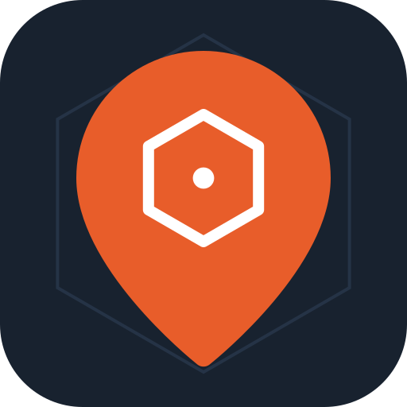

# Spotorders

**Where should I wait so the next delivery order comes fastest?**

Spotorders is an Android app and a small GIS pipeline that learn this from my own delivery history in Helsinki.
I built it for myself. It is not a product, and it is not connected to Wolt in any way.


## Why I built this

I'm a master's student in Ecology and Evolutionary Biology at the University of Helsinki. Like many
international students in Finland, I have not been able to find a job in my field or even a regular part-time
job, so I deliver food for Wolt on an e-bike to pay the bills.

The hardest part of the job is not the riding. It's the waiting. Between orders you stand outside a restaurant
or a shopping centre, in the rain or at minus five, not knowing whether the next order will come in two
minutes or in forty. Waiting time is unpaid. Pick the wrong corner on a Tuesday afternoon and you can lose
half an hour. Pick the right one on a Friday evening and the orders come back to back.

After a few months I noticed I was already guessing: Redi on Friday nights, Arabia at lunch, Hakaniemi when it
rains. As an ecologist, I recognised the problem. It's what animals do when they forage: choose a patch,
wait, decide when to move. Ecologists model exactly that. So instead of guessing, I started measuring.

Spotorders is the result: a one-tap logger on my phone and a pipeline that turns my shifts into a map of
where I wait the least, by hour, weekday and weather.

## How it works

```
 phone (during a shift)                    GitHub
 ─────────────────────                     ──────────────────────────────────────────────
 Start shift ─┐                            spotorders-data (PRIVATE)
 O (order) ───┼─ saved on phone ──upload──► live/events.csv   every button press
 D (deliver) ─┤  + GPS every 15 s          live/fixes/*.csv  GPS track
 End shift ───┘                                   │
                                                  ▼  workflow starts within a minute
                                           spotorders (PUBLIC, this repo)
                                           pipeline: waits, weather, H3 hexagons
                                           → data/sample/*.csv, figures/*.png (summaries only)
```

1. **During a shift I only press buttons.** Two floating buttons sit on top of every app, like old
   Messenger chat heads: **O** when I get an order, **D** when it's delivered. With the phone in a holder and
   winter gloves on, one big tap beats pulling down the notification shade. Each press saves the time and my
   GPS position. (The same buttons are also in the notification.)
2. **The app uploads automatically** to a private GitHub repo whenever there is internet. With no signal,
   it waits and retries.
3. **Each new order triggers a GitHub Actions run** that rebuilds the dataset: it measures how long I waited
   (from D to the next O), matches the position to the nearest restaurant, adds the weather from
   Open-Meteo, and updates the public summaries and charts in this repo.
4. **The app's Map tab** downloads the result (`data/sample/app_map.json`) and colours H3 hexagons over an
   OpenStreetMap base map by expected wait for the current time of day, green to red. A card names the best
   spot within 3 km, counting the ride there at half weight. Hexagons where I have never waited get an
   estimate from OpenStreetMap restaurant density, so the map is useful from day one and learns from every shift.

## Privacy by design

My GPS track shows where I live and when I work, so I treat it as private from the start:

- **Raw data never enter this public repo.** Button presses and GPS tracks go only to a private repo.
  `data/private/` is git-ignored here.
- **What is public:** counts and waiting times per hexagon (H3, about 170 m to 900 m across), times rounded
  to 15 minutes, no calendar dates, no exact coordinates, no earnings.
- **Customers' addresses stay out of the data.** No GPS is logged during a delivery (between O and D), the
  D tap is stored only to about 100 m, and logging resumes once I'm 200 m away or 3 minutes later. The model only
  needs where I *wait*.
- The GitHub token on the phone is encrypted with the Android Keystore and only sent to api.github.com.
- One-tap input only. Buttons are pressed at the restaurant or the customer's door, never while riding.

## What the data say so far

The first dataset comes from 33 screenshots of my courier history, September to November 2026:
**189 tasks over 43 shifts on 31 days**. I transcribed them by hand and checked every daily total
against the app. Early observations, from a small sample:

- Friday evening, 18:00 to 21:00, is by far my busiest window.
- My estimated median wait between tasks is about **16 minutes**: about 13 at lunch, about 17.5 late in the evening.
- Waits were shorter in rainy hours (about 13 vs 17 minutes), which matches the idea that people order
  more when it rains.


For the screenshot history, my position is simulated 20–50 m from the restaurant, and the wait is estimated
(one timestamp per task). From now on, the app records both for real, and `wait_is_estimated` tells the two apart.

## Success measure

Orders partly arrive at random, so prediction accuracy is not the goal. The test is:
**is my average wait shorter in recommended spots than in my usual spots?**
I'll add a before/after chart here once the app has logged enough shifts.

## Roadmap

| Phase | What | Status |
|---|---|---|
| 1 | Dataset from screenshots, weather join, first heatmaps | done |
| 2 | Android logger: GPS, floating O/D buttons, automatic upload to GitHub | done, in daily use |
| 3 | Map tab: H3 hexagons coloured by expected wait, best spot now | done |
| 4 | Model: smoothed statistics with an OpenStreetMap density prior (now) → gradient boosting with weather | smoothed version live in `pipeline/app_map.py` |

## Repo layout

| Path | What |
|---|---|
| `android/` | Kotlin, Jetpack Compose, Room, WorkManager, fused location |
| `pipeline/` | Python: `build_dataset`, `live` (app log → orders), `weather`, `geo`, `baseline`, `app_map`, `figures` |
| `data/sample/` | public, privacy-safe tables updated by the workflow |
| `data/reference/` | restaurant coordinates and the weather hours for the screenshot history |
| `docs/` | [phone setup](docs/INSTALL.md), [data dictionary](docs/data_dictionary.md) |
| `.github/workflows/` | APK build and release; dataset update after each upload |

## Run the pipeline yourself

```bash
pip install -r requirements.txt
python -m pipeline.build_dataset   # needs data/private (the private data repo)
python -m pipeline.baseline
python -m pipeline.figures
python -m pipeline.app_map         # the hexagon map the phone app shows
```

## Limitations

- One courier, a few hundred tasks: hexagons with fewer than 5 observations mostly show the prior.
- The wait is attributed to where the next offer arrived, which favours places I already go to.
  OpenStreetMap restaurant density will be the prior for unexplored places.
- Platform dispatch rules are unknown and change. This only describes what happened to me.

## Disclaimer

Independent personal project. Not affiliated with, endorsed by or connected to Wolt. It uses no Wolt API and
does not read, scrape or automate the Wolt apps: all data are my own button presses and my own records.

## License

MIT
