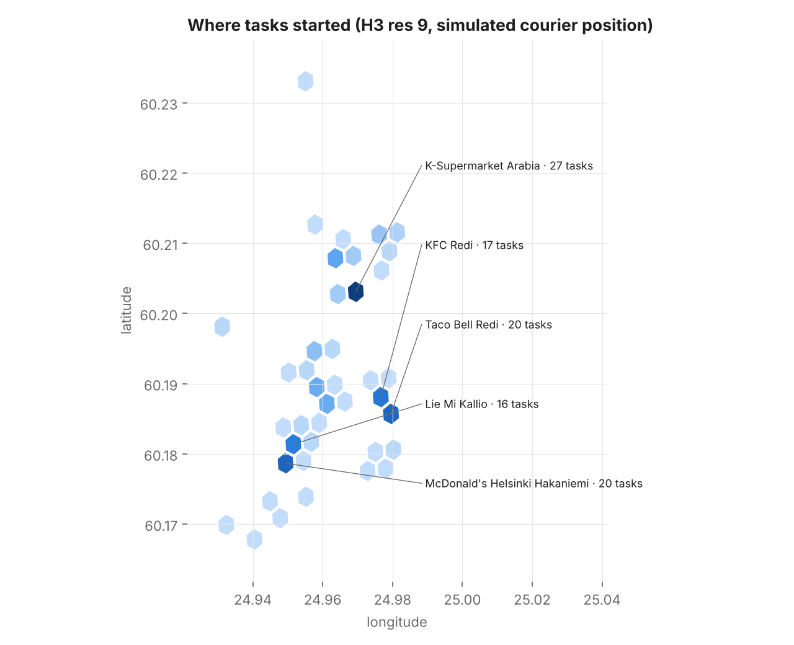

# Spotorders

**Where should a bike courier wait to get the next order fastest?**
Spotorders is a personal GIS project: an Android logger plus a Python pipeline that learns, from my own
Wolt courier history in Helsinki, which spots give the shortest wait for the next task at a given hour,
weekday and weather.

> Independent hobby project. Not affiliated with, endorsed by or connected to Wolt. It uses no Wolt API and
> does not scrape or automate the Wolt apps: all data are my own records, transcribed by hand or logged on my phone.


## How success is measured

Orders partly arrive at random, so "95 % accuracy" is meaningless here. The test is simpler:
**is my average wait until the next order shorter in recommended spots than in my usual spots?**
That before/after comparison will be added here once the logger has collected enough shifts.

## Status

| Phase | What | Status |
|---|---|---|
| 1 | First dataset from courier-history screenshots, weather join, first heatmaps | **done** (this commit) |
| 2 | Android logger: foreground GPS, one-tap "got order" / "free again", CSV export | skeleton in `android/` |
| 3 | Hexagon map of expected wait in the app, nearest good spot | planned |
| 4 | Model: smoothed statistics → gradient boosting, restaurant density as prior | baseline in `pipeline/baseline.py` |

## The first dataset (Sep–Nov 2026)

189 tasks (196 deliveries) over 43 shifts on 31 days, transcribed from 33 screenshots of the courier app's
earnings history. Every daily total in the transcription matches the total shown in the app.

How each row was built:

1. **Pickup venue → coordinates.** 81 of 86 venues were placed from OpenStreetMap, a street address, or the
   shopping centre they sit in (Redi, Arabia). Seven are only known by district and use the district centroid;
   five could not be placed and have no position (`geocode_quality` says which is which).
2. **Courier position.** When an offer arrives I am usually waiting near a restaurant, so the position is
   simulated as a random point **20–50 m from the pickup venue** (uniform over the ring, fixed seed). These are
   stand-ins until real GPS logs from the app replace them.
3. **Waiting time.** The app gives one timestamp per task. Within a shift, the gap between two tasks minus an
   estimate of how long the previous task took (6 min handling + distance at 14 km/h + 4 min per extra
   stop) gives `est_wait_min`. Median: about 16 minutes.
4. **Weather.** Hourly Open-Meteo data for central Helsinki (temperature, feels-like, precipitation, rain,
   snow, wind, humidity, cloud cover, WMO code), joined on the task's hour, plus rain in the previous two hours.
5. **Features for modelling.** Weekday, weekend, Friday/Saturday evening, cyclic hour, time bucket, sun elevation
   and darkness, H3 cells at resolution 8 and 9.



### Files

| File | Content | In git? |
|---|---|---|
| `data/private/orders_raw.csv` | the transcription | no |
| `data/private/orders_enriched.csv` | full table, exact times and pay | no |
| `data/sample/orders_public.csv` | same rows, **no pay, no calendar date, times rounded to 15 min** | yes |
| `data/sample/hex_training_table.csv` | counts and median wait per hexagon × time bucket × day type × weather | yes |
| `data/sample/spot_ranking.csv` | smoothed expected wait per hexagon and time bucket (baseline) | yes |
| `data/reference/venues.csv` | pickup venues with coordinates and how they were found | yes |
| `data/reference/weather_hourly.csv` | the weather hours used | yes |

Column definitions: [`docs/data_dictionary.md`](docs/data_dictionary.md).

## Run it

```bash
pip install -r requirements.txt
python -m pipeline.build_dataset   # needs data/private/orders_raw.csv
python -m pipeline.baseline
python -m pipeline.figures
```

The Android project in `android/` opens in Android Studio (Kotlin, Jetpack Compose, Room,
fused location). It has not been built in CI yet.

## Privacy rules for this repo

- No raw GPS tracks and no exact pickup or drop-off times tied to addresses are committed.
  `data/private/` is git-ignored.
- Published task data have no earnings, no calendar dates, and times rounded to 15 minutes.
- Drop-off locations are never recorded.
- The app only uses one-tap input and is never meant to be used while riding.

## Limitations

- 189 tasks from one courier is a small sample. Rankings with `n < 5` are mostly the prior.
- Positions are simulated, not measured. The waiting time is an estimate, because the app history has
  one timestamp per task and no "became free" time. The logger app fixes both.
- The wait is attributed to the spot where the next offer arrived, which favours places I already go to.
  Restaurant density from OpenStreetMap will be used as a prior for places with little data.

## License

MIT
